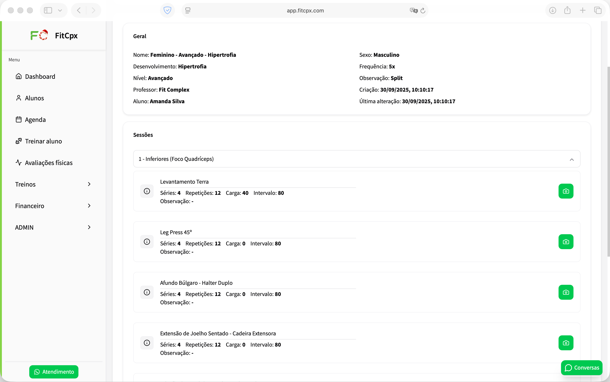
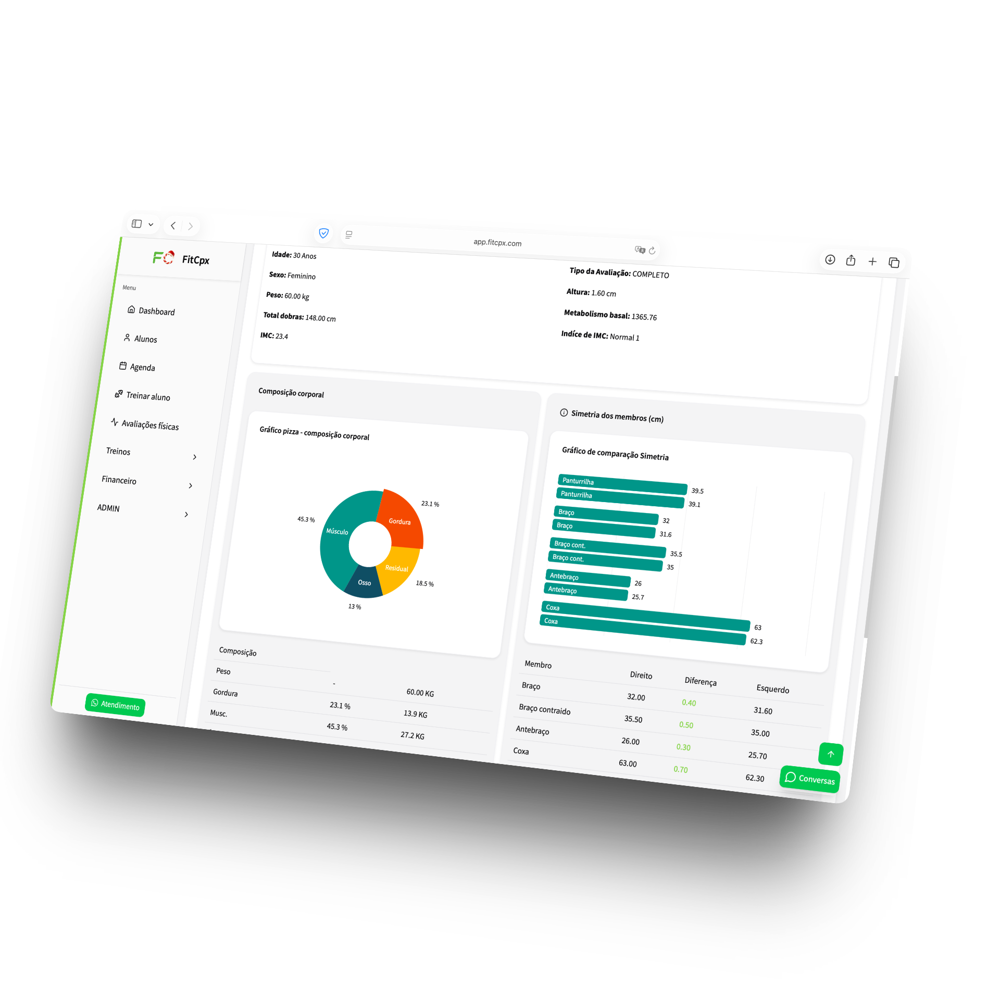
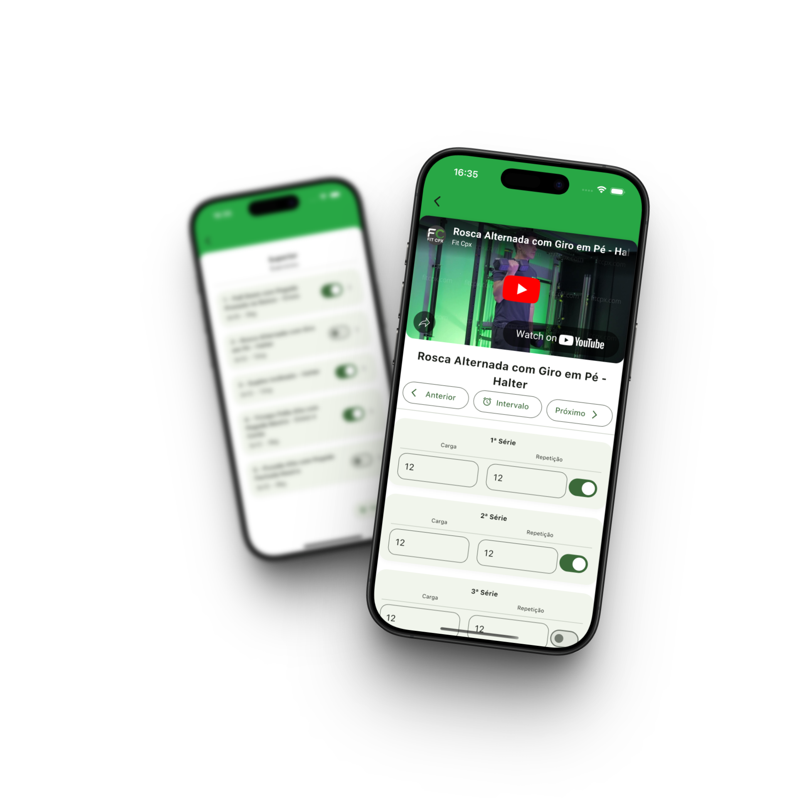

<p align="right"><a href="README.md">🇺🇸 English</a> · <strong>🇧🇷 Português</strong></p>

<p align="center"></p>

<h1 align="center">FitCPX — Plataforma Web</h1>
<p align="center"><strong>SaaS de gestão fitness desenvolvido para operações reais.</strong></p>
<p align="center"><a href="https://fitcpx.com">Site oficial</a> · <a href="#visão-geral">Visão geral</a> · <a href="#engenharia">Engenharia</a> · <a href="#aplicativos-móveis">Aplicativos</a></p>
<p align="center"><code>React</code> · <code>TypeScript</code> · <code>Vite</code> · <code>TanStack Query</code> · <code>Playwright</code></p>

---

## Visão geral

O FitCPX é uma plataforma SaaS comercial que ajuda personal trainers e empresas do setor fitness a administrar suas operações. O sistema reúne **gestão de alunos, prescrição de treinos, avaliações físicas, agendamentos, contratos e pagamentos** em uma única aplicação.

Desenvolvi e mantive o frontend web, transformando requisitos do produto em interfaces e fluxos utilizados em diferentes áreas da plataforma. Este repositório contém essa **aplicação React/TypeScript**, com histórico de desenvolvimento desde **novembro de 2024**.

O backend e os aplicativos móveis são projetos separados, apresentados mais adiante para contextualizar o ecossistema.

## O produto na prática

### Prescrição de treinos

Os profissionais podem montar rotinas, organizar sessões, selecionar exercícios e configurar séries, repetições e cargas.

<p align="center"></p>

### Avaliações físicas e relatórios

A plataforma permite trabalhar com medidas, acompanhamento da composição corporal e relatórios visuais, facilitando a análise da evolução dos alunos.

<p align="center"></p>

### Além dos treinos

A aplicação web inclui perfis de empresas e alunos, dashboards operacionais, fluxos ligados à agenda, contratos, assinaturas e interfaces de cobrança. Esses módulos compõem processos conectados, e não apenas telas isoladas de demonstração.

## Engenharia

O frontend combina uma aplicação React modular com fluxos de negócio, componentes compartilhados e integrações de API.

| Área | Implementação |
| --- | --- |
| **Estrutura da aplicação** | Módulos de funcionalidades em `src/modules`, componentes e hooks reutilizáveis |
| **Formulários e fluxos** | React Hook Form, validação e interfaces com várias etapas |
| **Dados do servidor** | Camada de API e TanStack Query para requisições e sincronização de dados |
| **Interfaces com muitos dados** | Tabelas, grids, dashboards e gráficos de avaliação |
| **Estado e navegação** | React Router e gerenciamento de estado no cliente |
| **Internacionalização** | i18next e react-i18next |
| **Desenvolvimento e entrega** | Vite, Playwright, Docker, Nginx e workflows históricos de CI/CD documentados |

**Tecnologias presentes no projeto:** React 18, TypeScript, Vite, Tailwind CSS, Radix UI, React Bootstrap, TanStack Query, React Hook Form, Recoil, Zustand, TanStack Table, AG Grid, Recharts e ApexCharts.

O repositório reúne anos de alterações incrementais, manutenção e refatorações. Seu histórico Git mostra a evolução de um produto em operação, não de uma demonstração criada pontualmente.

## Aplicativos móveis

O ecossistema FitCPX também conta com dois aplicativos móveis, cada um com seu próprio código-fonte.

### FitCPX – Aluno

Aplicativo para alunos vinculados a profissionais e empresas que utilizam a plataforma FitCPX. Permite consultar treinos prescritos, demonstrações dos exercícios, resultados de avaliações e informações de pagamentos.

<p align="center"></p>

**Android:** [Google Play](https://play.google.com/store/apps/details?id=com.devcomplexlab.alunofitcpx) · **iOS:** [App Store](https://apps.apple.com/br/app/fitcpx-aluno/id6749808580)  
**Código-fonte:** projeto Flutter separado.

### FitCPX – Biblioteca de Exercícios

Aplicativo independente para Android e iOS com **mais de 690 exercícios**, vídeos demonstrativos e informações técnicas. Pode ser utilizado sem uma conta vinculada a um profissional ou empresa cadastrada na plataforma FitCPX.

**Android:** [Google Play](https://play.google.com/store/apps/details?id=com.devcomplexlab.fitcpx) · **iOS:** [App Store](https://apps.apple.com/us/app/fitcpx/id6749830273)  
**Código-fonte:** projeto mobile separado.

## Estrutura do repositório

```text
src/
├── api/             # Comunicação com o backend
├── components/      # Componentes reutilizáveis
├── hooks/           # Hooks compartilhados
├── modules/         # Funcionalidades de negócio
├── routes/          # Navegação
├── states/          # Estado da aplicação
└── types/           # Definições de tipos
public/              # Arquivos estáticos
tests/               # Testes Playwright
docs/
├── screenshots/     # Imagens do produto utilizadas aqui
└── legacy-workflows/ # Configurações históricas de deploy
```

## Executando localmente

É necessário ter Node.js, dependências npm e uma API de desenvolvimento compatível.

```bash
npm install
cp .env.example .env.local
npm run dev
```

Configure `VITE_API_URL` em `.env.local` para apontar ao backend de desenvolvimento. Para gerar o build:

```bash
npm run build
```

Algumas funcionalidades e testes de ponta a ponta dependem de serviços e credenciais de teste que não estão incluídos neste repositório de frontend.

## Links

- **Site:** [fitcpx.com](https://fitcpx.com)
- **Produto:** FitCPX — LAB COMPLEX DEV LTDA

Este repositório documenta o frontend web do FitCPX. O produto e seu código-fonte permanecem sujeitos aos direitos de seus respectivos titulares; nenhuma licença de código aberto é concedida implicitamente.
